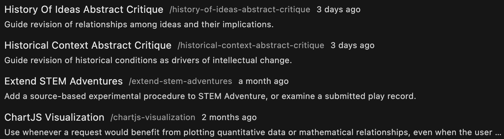
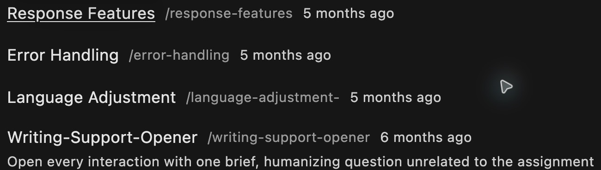
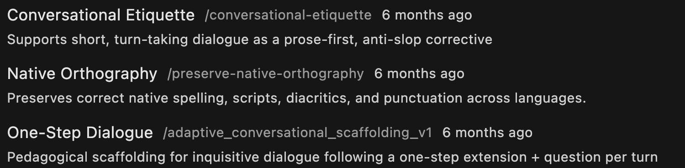
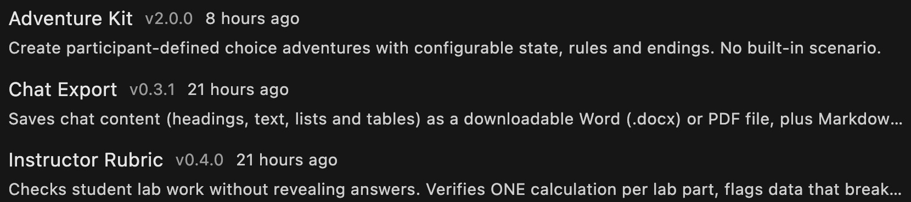
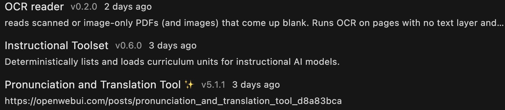
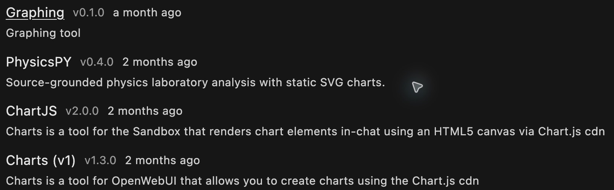
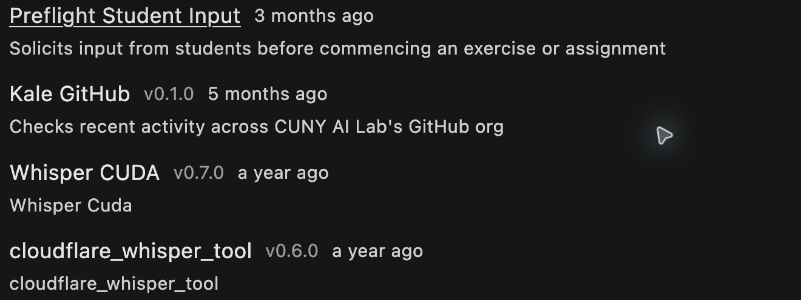
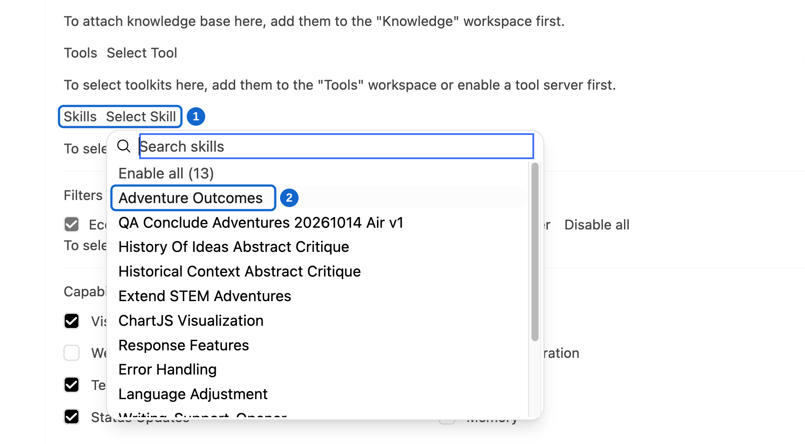

# Configuring skills and tools

## 1. Configuring skills and tools

[](https://ailab.gc.cuny.edu/)


New Media Lab · Room 7388.01
CUNY Graduate Center

Thursday, October 15, 2026   2:30–4:00 p.m. Eastern

Developed by Zach Muhlbauer

[https://cuny-ai-lab.github.io/sandbox-series/skills](https://cuny-ai-lab.github.io/sandbox-series/skills)

---

## 2. Choose Your Own Adventure

Continue your saved model or clone it first

Open **Workspace → Models → Edit**
Read your actual system prompt
Identify setting, goals, and rules

Keep this model card open while you add a skill and a tool

Select **Workspace** in left sidebar, then **Models**. Search for **STEM Adventure Games**. Open **⋯** beside it and select **Clone**.


---

## 3. What Is a Skill?

**Skills** contain plain-text instructions for repeatable tasks

Trigger

Request or condition that starts a procedure

Procedure

Steps, checks, and points that require a question

Output

Required response content and form

---

## 4. Skill Examples

Workspace → Skills · 1 of 3
Examples from the host’s catalog. Your list depends on access



---

## 5. Skill Examples

Workspace → Skills · 2 of 3
Examples from the host’s catalog. Your list depends on access



---

## 6. Skill Examples

Workspace → Skills · 3 of 3
Examples from the host’s catalog. Your list depends on access



---

## 7. Add Your Skill

In **Workspace → Models → Edit**, find **Skills → Select Skill**

Choose existing **Extend Adventure Games**

Read its saved instructions
Keep this model card open for Adventure Kit

---

## 8. What Is a Tool?

When a model calls a **tool**, Sandbox executes a function and returns its result

**Tool calling**, otherwise known as **function calling**, sends a function name and arguments for execution

Input

Arguments supplied to a function

Execution

Code that applies specified rules

Result

Returned output for a model to inspect

---

## 9. Tool Examples

Workspace → Tools · 1 of 4
Examples from the host’s catalog. Your list depends on access



---

## 10. Tool Examples

Workspace → Tools · 2 of 4
Examples from the host’s catalog. Your list depends on access



---

## 11. Tool Examples

Workspace → Tools · 3 of 4
Examples from the host’s catalog. Your list depends on access



---

## 12. Tool Examples

Workspace → Tools · 4 of 4
Examples from the host’s catalog. Your list depends on access



---

## 13. Enable Filter

Enable **Model Bound Tool Enabler** on your model card.
Why: It restores attached tools when a chat omits them.


---

## 14. Add the ‘Adventure Kit’ tool

In this same model card, open **Tools → Select Tool**
Choose **Adventure Kit** · Confirm **Extend Adventure Games** remains selected
Add next prompt instruction, then click **Save & Update** before testing


---

## 15. Model Card Check

Ensure that your model card has a knowledge collection, tool, skill, and filter configured like the image below.


---

## 16. Add Skill Instructions

```text
Load the extend_adventure_games skill and follow it on every turn, calling the adventure_kit tool only as the skill directs. Use no other skills or tools.
```

---

## 17. Test Your Adventure

Run your updated adventure game
Verify configured skill and tool are called appropriately
Then play the rest of your game

---

## 18. Observe Game Results

① Check skill call · ② Check tool call
Open details to confirm selected skill


---

## 19. Explore Other Skills

After your first adventure works, try **Adventure Outcomes** or **Conclude Adventures** if available
Read saved instructions · Change one item · Save your model card and compare results



---

## 20. Choose Your Task

### Revise One Item

Copy complete tool code or skill instructions

Describe an observed problem and one change

### Create Your Own

Choose your own tool or skill

Specify purpose, required input, and expected result

[Copy tool code](navigation.html#tool-copy) · [Skill instructions](navigation.html#skill-copy)

---

## 21. Work With Support

Open **CAIL Workspace Support**
Paste original content or your new task, system prompt, and required sources
Request complete content, an explanation, and one test · [Copy request](exercises.html#work-with-support)


---

## 22. Adapt Your Adventure

Bring a lesson outcome, weekly concept, and current adventure to **CAIL Workspace Support**

Ask it to revise your orchestration skill or tool, or design a new one
Supply complete content, system prompt, scenario, and play record

Review proposed changes before running them · [Copy Support request](exercises.html#adapt-your-adventure)

---

## 23. Add Tools or Skills

Create a new **tool** or **skill**, or save a revised copy
Use **Workspace → Tools → Create** or [**Skills → Create**](navigation.html#create-skill)
Enter new Name and ID; paste complete reviewed content

Review **Access**, then **Save & Create** · [Select and test your item](exercises.html#add-new-version)


---

## 24. Series Reflections

What task in your teaching or research could benefit from a skill or tool?

Would you be interested in joining our coworking session on October 29,  2–4pm,  to build your adventure into a collection so that we can showcase our work over the course of the series?

What would you develop next with the prompts, knowledge collections, skills, and tools you have explored?
