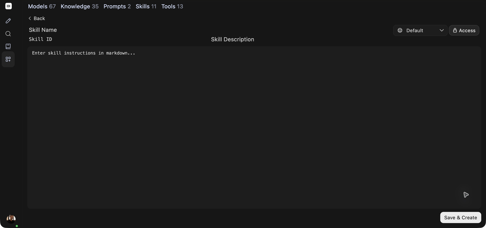
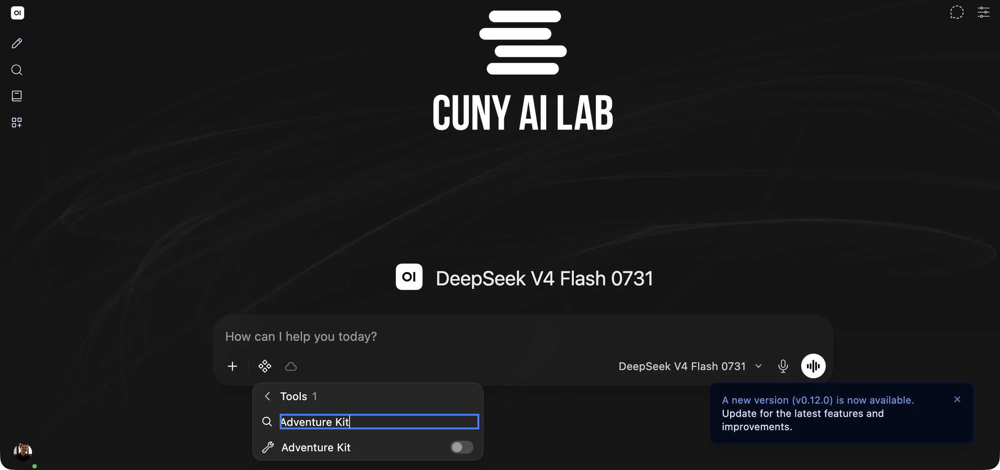
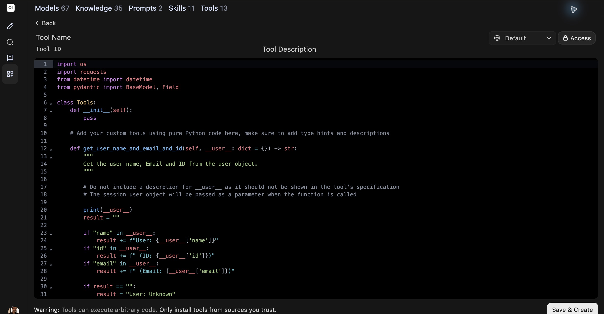

# Configuring skills and tools

## Configuring skills and tools — 1

### Configuring skills and tools

New Media Lab · Room 7388.01
CUNY Graduate Center

Thursday, October 15, 2026   2:30–4:00 p.m. Eastern

[https://cuny-ai-lab.github.io/sandbox-series/skills](https://cuny-ai-lab.github.io/sandbox-series/skills)

---

## Configuring skills and tools — 2

### Continue Your Model

Choose your saved model below message box
Read its system prompt for setting, goals, and rules
[Clone route](navigation.html#clone) · [Earlier instructions and sources](exercises.html#clone-or-continue)

---

## Configuring skills and tools — 3

### Skill Procedures

A skill is a plain-text procedure for a repeatable task

Trigger

When a procedure applies

Procedure

Steps, conditions, and points that require a question

Output

Required response shape

---

## Configuring skills and tools — 4

### Add Your Skill

Open **Workspace → Skills → Create**
Enter Name, ID, Description, and [complete instructions](../examples/adventure-kit/conclude-adventure.html)
Review **Access**, then **Save & Create**

---

## Configuring skills and tools — 5

### Test Your Skill

Select your copy through **Integrations → Skills**

Ask whether an observed record satisfies prompt goals
Withhold required evidence and check for a question
Ask to stop with unfinished goals and check its response

Which task in your teaching or research needs a repeatable procedure?

---

## Configuring skills and tools — 6

### Tool Actions

A tool is a function a model calls to execute an operation

Input

Data for an operation

Execution

Code that applies specified rules

Result

Output a model can inspect or discuss

---

## Configuring skills and tools — 7

### Add Adventure Kit

Open **Integrations → Tools**
Search **Adventure Kit** and select its toggle

---

## Configuring skills and tools — 8

### Prepare Your Adventure

Setting, goals, and rules come from your system prompt

Ask your model to show how those instructions map into scene, choices, and end conditions

Resolve absent or contradictory instructions
Review proposed input, then run **Adventure Kit**

[Copy preparation and run requests](exercises.html#add-and-test-tool)

---

## Configuring skills and tools — 9

### Test Your Tool

Compare rendered scene and choices with your prompt

Try a choice before and after its prerequisite
Inspect Undo and Stop
Copy actual play record into chat

Which step in your teaching or research needs an executable operation?

---

## Configuring skills and tools — 10

### Choose Your Task

### Revise One Item

Copy complete tool code or skill instructions

Describe an observed problem and one change

### Create Your Own

Choose your own tool or skill

Specify purpose, required input, and expected result

[Tool copy route](navigation.html#tool-copy) · [Skill instructions](../examples/adventure-kit/conclude-adventure.html)

---

## Configuring skills and tools — 11

### Work With Support

Open **CAIL Workspace Support**
Paste original content or your new task, system prompt, and required sources
Request complete content, an explanation, and one test · [Copy request](exercises.html#work-with-support)

---

## Configuring skills and tools — 12

### Create Your Tool

Open **Workspace → Tools → Create**
Enter new Name and ID; replace sample code completely
Review **Access**, then **Save & Create**

For a skill, use [Skills → Create](#4) · Select new copy and [repeat original test](exercises.html#add-new-version)

---

## Configuring skills and tools — 13

### Series Reflections

What task in your teaching or research could benefit from a skill or tool?

Across the series, how has your approach to custom models changed?

What would you develop next with the prompts, knowledge collections, skills, and tools you have explored?
