# Configuring skills and tools

## Configuring skills and tools — 1

[](https://ailab.gc.cuny.edu/)

### Configuring skills and tools

New Media Lab · Room 7388.01
CUNY Graduate Center

Thursday, October 15, 2026   2:30–4:00 p.m. Eastern

Developed by Zach Muhlbauer

[https://cuny-ai-lab.github.io/sandbox-series/skills](https://cuny-ai-lab.github.io/sandbox-series/skills)

---

## Configuring skills and tools — 2

### Choose Your Own Adventure

Continue your saved model or clone it first

Open **Workspace → Models → Edit**
Read your actual system prompt
Identify setting, goals, and rules

Keep this model card open while you add a skill and a tool

Select **Workspace** in left sidebar, then **Models**. Search for **STEM Adventure Games**. Open **⋯** beside it and select **Clone**.

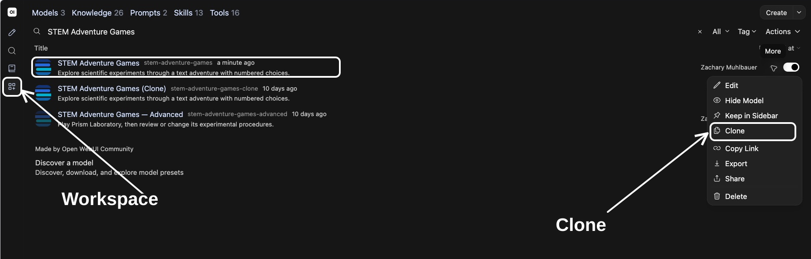

---

## Configuring skills and tools — 3

### What Is a Skill?

**Skills** contain plain-text instructions for repeatable tasks

Trigger

Request or condition that starts a procedure

Procedure

Steps, checks, and points that require a question

Output

Required response content and form

---

## Configuring skills and tools — 4

### Skill Examples

### Extend Adventure Games

Follow a saved adventure procedure

Call Adventure Kit as directed by the skill

Read the saved instructions in **Workspace → Skills**

---

## Configuring skills and tools — 5

### Add Your Skill

In **Workspace → Models → Edit**, find **Skills → Select Skill**

Choose existing **Extend Adventure Games**

Read its saved instructions
Keep this model card open for Adventure Kit

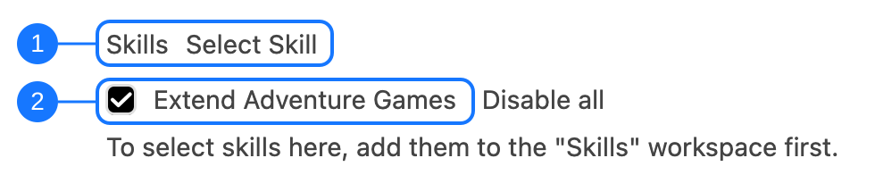

---

## Configuring skills and tools — 6

### What Is a Tool?

When a model calls a **tool**, Sandbox executes a function and returns its result

**Tool calling**, otherwise known as **function calling**, sends a function name and arguments for execution

Input

Arguments supplied to a function

Execution

Code that applies specified rules

Result

Returned output for a model to inspect

---

## Configuring skills and tools — 7

### Tool Examples

Workspace → Tools
Examples from the host’s catalog. Your list depends on access

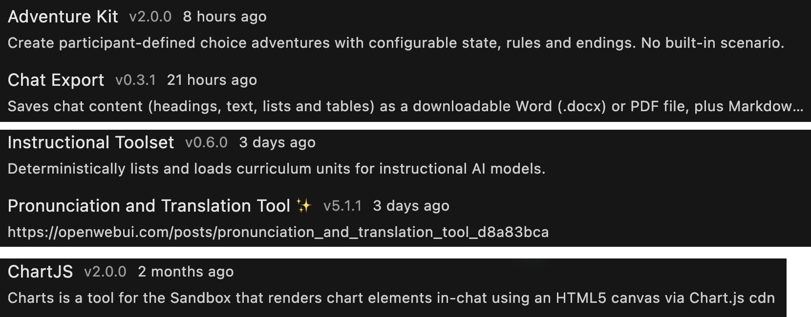

---

## Configuring skills and tools — 8

### Update Model for Tool Calling

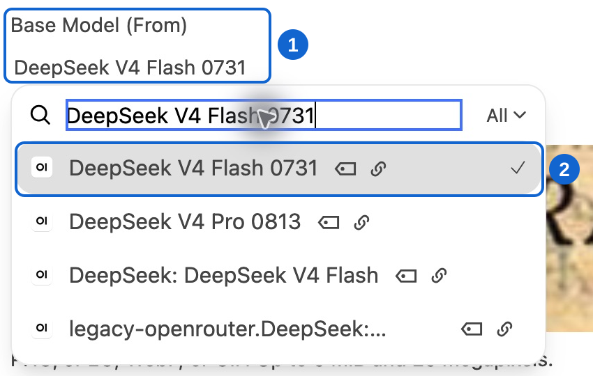

---

## Configuring skills and tools — 9

### Enable Filter

Enable **Model Bound Tool Enabler** on your model card.
Why: It restores attached tools when a chat omits them.

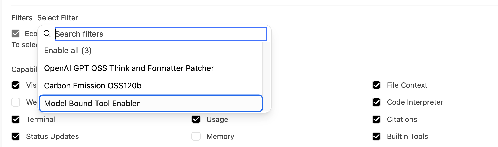

---

## Configuring skills and tools — 10

### Add the ‘Adventure Kit’ tool

In this same model card, open **Tools → Select Tool**
Choose **Adventure Kit** · Confirm **Extend Adventure Games** remains selected
Add next prompt instruction, then click **Save & Update** before testing

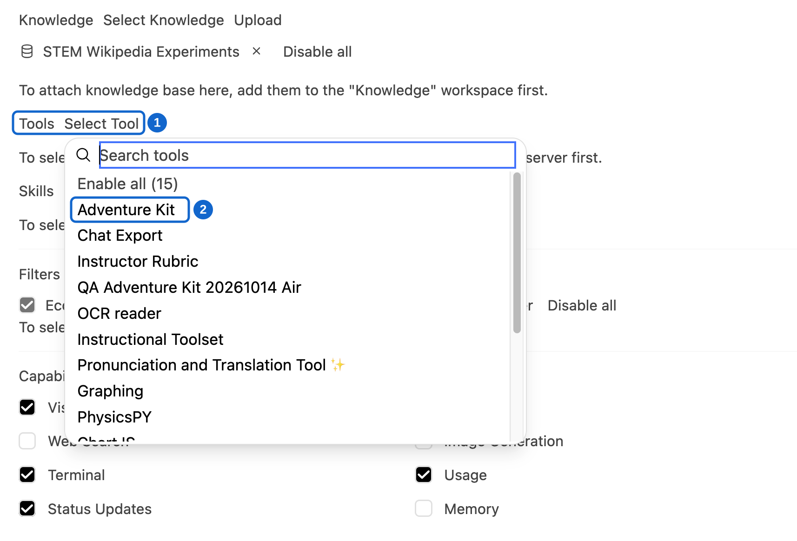

---

## Configuring skills and tools — 11

### Model Card Check-In

Ensure that your model card has a knowledge collection, tool, skill, and filter configured like the image below.

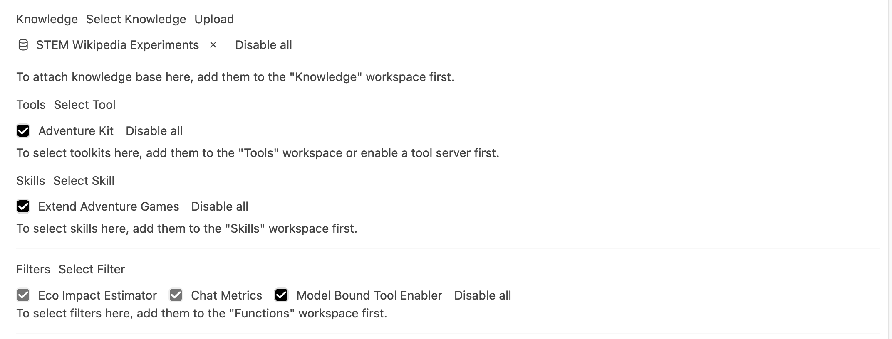

---

## Configuring skills and tools — 12

### Add Skill Instructions to the Bottom of Your System Prompt

```text
Load the extend_adventure_games skill and follow it on every turn, calling the adventure_kit tool only as the skill directs. Use no other skills or tools.
```

---

## Configuring skills and tools — 13

### Test Your Adventure

Run your updated adventure game
Verify configured skill and tool are called appropriately
Then play the rest of your game

---

## Configuring skills and tools — 14

### Observe Game Results

① Check skill call
② Check tool call

Open details to confirm selected skill

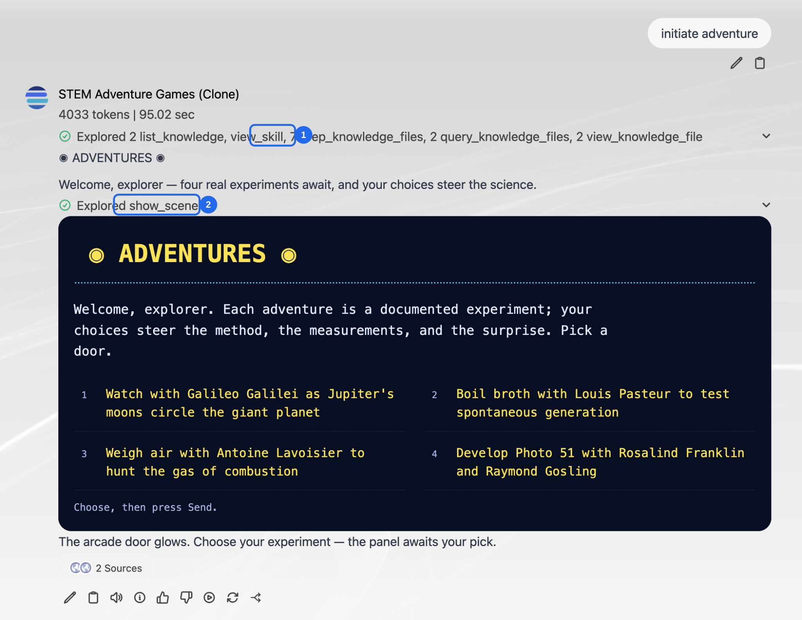

---

## Configuring skills and tools — 15

### Explore Other Skills

After your first adventure works, try **Adventure Outcomes** or **Conclude Adventure Game** if available

Read saved instructions · Change one item · Save your model card and compare results

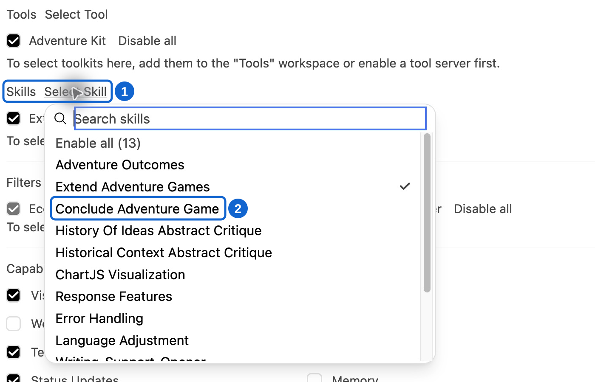

---

## Configuring skills and tools — 16

### Choose Your Task

### Revise One Item

Copy complete tool code or skill instructions

Describe an observed problem and one change

### Create Your Own

Choose your own tool or skill

Specify purpose, required input, and expected result

[Copy tool code](navigation.html#tool-copy) · [Skill instructions](navigation.html#skill-copy)

---

## Configuring skills and tools — 17

### Work With Support

Open **CAIL Workspace Support**
Paste original content or your new task, system prompt, and required sources
Request complete content, an explanation, and one test · [Copy request](exercises.html#work-with-support)

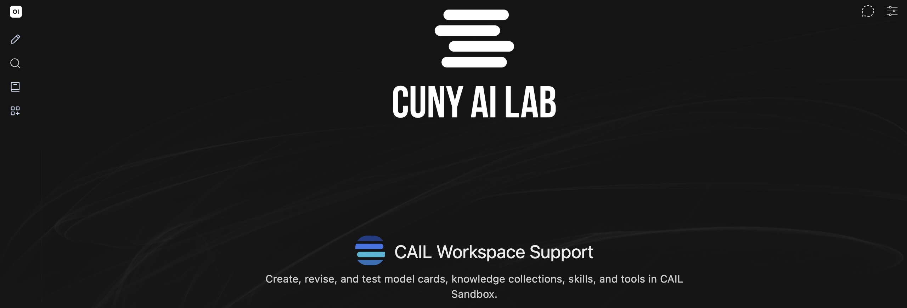

---

## Configuring skills and tools — 18

### Adapt Your Adventure

Introduce a lesson plan, learning outcome, or disciplinary focus to your use of **CAIL Workspace Support** card

Prompted to generate a skill and/or tool that continues to support or further extends your adventure game, either adapting an existing skill or tool, or making your own.

---

## Configuring skills and tools — 19

### Add Tools or Skills

Copy and paste all code, then save your item.

On your model card, select your new tool or skill.

Update the system prompt to tell the model which tool to use and when. Save the model card.

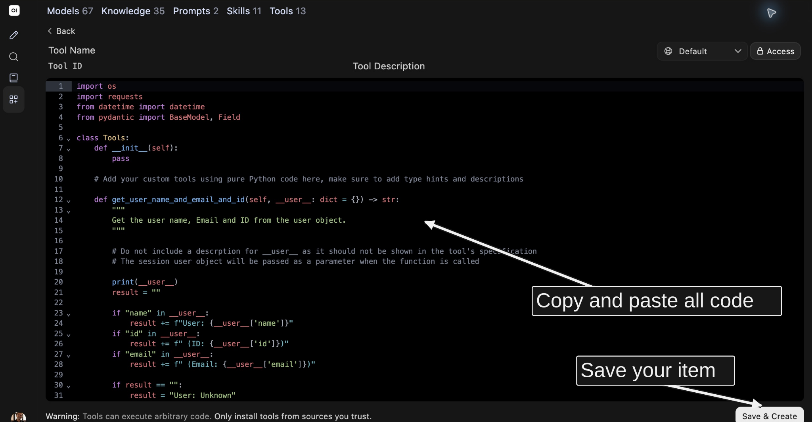

---

## Configuring skills and tools — 20

### Series Reflections

What task in your teaching or research could benefit from a skill or tool?

Would you be interested in joining our coworking session on October 29,  2–4pm,  to build your adventure into a collection so that we can showcase our work over the course of the series?

What would you develop next with the prompts, knowledge collections, skills, and tools you have explored?
