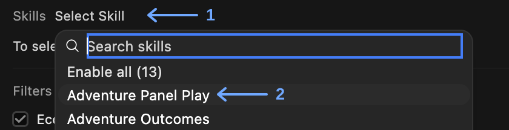
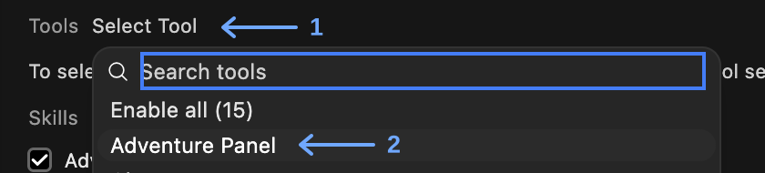
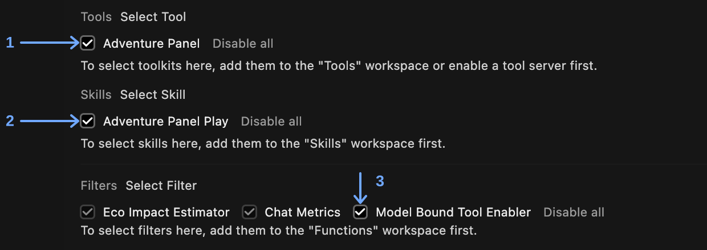
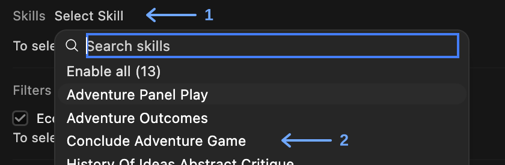
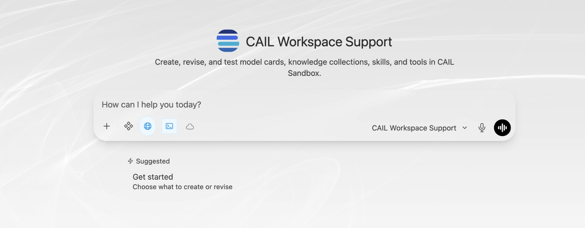

# Configuring skills and tools

## Configuring skills and tools — 1

[](https://ailab.gc.cuny.edu/)

### Configuring skills and tools

Led by  Zach Muhlbauer  and  Meha Gupta

New Media Lab · Room 7388.01
CUNY Graduate Center

Thursday, October 15, 2026   2:30–4:00 p.m. Eastern

[https://cuny-ai-lab.github.io/sandbox-series/skills](https://cuny-ai-lab.github.io/sandbox-series/skills)

---

## Configuring skills and tools — 2

### Choose Your Own Adventure

1. Continue your saved model, or clone **STEM Adventure Games** in **Workspace → Models → ⋯ → Clone**

2. Open **Workspace → Models → Edit** and review your system prompt’s setting, goals, and rules

3. Keep your model card open to add a skill and a tool


---

## Configuring skills and tools — 3

### What Is a Skill?

**Skills** contain plain-text instructions for repeatable tasks

Trigger

Request or condition that starts a procedure

Procedure

Steps, checks, and points that require a question

Output

Required response content and form

---

## Configuring skills and tools — 4

### What Is a Tool?

When a model calls a **tool**, it is given the ability to execute a function and return its result, usually through a Python script

This is called **tool calling** (aka **function calling**)

Input

Information passed to a function

Execution

Code that applies specified rules

Result

Returned output for a model to inspect

---

## Configuring skills and tools — 5

### Update Model for Tool Calling


---

## Configuring skills and tools — 6

### Enable Filter

Enable **Model Bound Tool Enabler** on your model card, which binds assigned tools to the model’s operations.


---

## Configuring skills and tools — 7

### Add Your Skill

1. Open **Workspace → Models → Edit → Skills → Select Skill**

2. Choose **Adventure Panel Play** and read its saved instructions

3. Keep your model card open to add **Adventure Panel**



---

## Configuring skills and tools — 8

### Add the ‘Adventure Panel’ tool

1. Open **Tools → Select Tool** on the same model card

2. Choose **Adventure Panel** and keep **Adventure Panel Play** selected

3. Add the system-prompt instructions on slide 10, then select **Save & Update**



---

## Configuring skills and tools — 9

### Model Card Check-In

Confirm these selections on your model card

1. **Adventure Panel** tool

2. **Adventure Panel Play** skill

3. **Model Bound Tool Enabler** filter

Keep your knowledge collection attached



---

## Configuring skills and tools — 10

### Add Skill Instructions to the Bottom of Your System Prompt

```text
Load the attached Adventure Panel Play skill (extend-adventure-games) and follow it on every turn. Use show_scene from the Adventure Panel tool to display each scene and its choices. Follow this system prompt’s setting, goals, rules, and source instructions.
```

---

## Configuring skills and tools — 11

### Test Your Adventure

1. Run your updated adventure game

2. Verify configured skill and tool are called appropriately

3. Then play the rest of your game

---

## Configuring skills and tools — 12

### Observe Game Results

1. Check the **Adventure Panel Play** skill call

2. Check the **Adventure Panel** tool call

Open call details to confirm the skill and show_scene function


---

## Configuring skills and tools — 13

### Explore Other Skills

1. Read **Adventure Outcomes** or **Conclude Adventure Game** after your first adventure works

2. Change one skill and save your model card

3. Run your adventure again and compare results



---

## Configuring skills and tools — 14

### Choose Your Task

### Revise One Item

1. Copy complete tool code or skill instructions

2. Describe an observed problem and one change

### Create Your Own

1. Choose a task for your tool or skill

2. Specify its purpose, required input, and expected result

[Copy tool code](navigation.html#tool-copy) · [Skill instructions](navigation.html#skill-copy)

---

## Configuring skills and tools — 15

### Work With Support

Prompt CAIL Workspace Support to generate a skill and/or tool that continues to support or further extends your adventure game, adapting an existing skill/tool or making your own.



---

## Configuring skills and tools — 16

### Adapt Your Adventure

1. Give **CAIL Workspace Support** your lesson plan, learning outcome, or disciplinary focus

2. Ask it to adapt or create a skill or tool that extends your adventure toward that outcome

---

## Configuring skills and tools — 17

### Add Tools or Skills

1. Copy and paste all code for tools or plain text for skills, then save your item

2. On your model card, select your new tool or skill, and signpost it in your system prompt


---

## Configuring skills and tools — 18

### CUNY AI Lab | Coworking Sessions

 CUNY AI Lab | Coworking Sessions  ➳   — reveal links

Continue your [Sandbox](../) and [Vibe Coding](https://ailab.gc.cuny.edu/events/#vibe-coding) projects in [coworking sessions](https://ailab.gc.cuny.edu/events/#coworking), with time to build and troubleshoot together.

[Workshop materials and guides  ➳](https://ailab.gc.cuny.edu/guides/)

 [Molnár · Quimbot / Creative Clawing](https://creative-clawing.com/artifacts/molnar.html)
